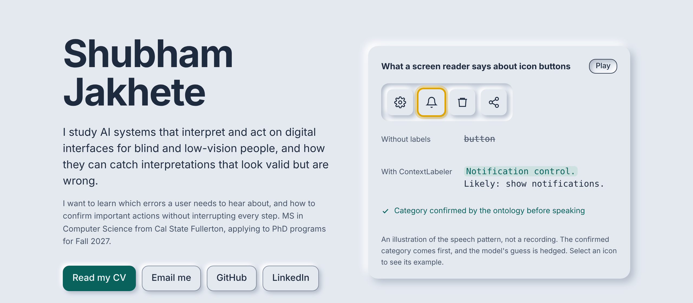

# Shubham Jakhete

<a href="https://shubhamjakhete.github.io">
  <picture>
    <source media="(prefers-color-scheme: dark)" srcset="assets/site-preview-dark.png">
    
  </picture>
</a>

**Website: [shubhamjakhete.github.io](https://shubhamjakhete.github.io)** · interactive demos of each project, plus my [CV](https://shubhamjakhete.github.io/cv.pdf)

I work on Human-Centered AI and accessibility, focusing on AI systems that interpret and act on digital interfaces for blind and low-vision people. I want to study how these systems can detect interpretations that look valid but are wrong, decide which errors a user needs to hear about, and confirm important actions without interrupting every step.

MS Computer Science, California State University, Fullerton (2026) · Applying to PhD programs for Fall 2027

[Website](https://shubhamjakhete.github.io) · [Email](mailto:shubhamsjakhete@gmail.com) · [LinkedIn](https://linkedin.com/in/shubham-jakhete)

---

## Research

### [ContextLabeler](https://github.com/shubhamjakhete/nvda_reader)
*Independent research, 2026 · Mentored by Richard Ladner (University of Washington)*

An NVDA screen reader add-on that labels unlabeled UI elements for blind users. An LLM (Claude Haiku) proposes each label, and SPARQL ASK queries check it against an RDF/Turtle ontology before NVDA speaks it. Speech gives the confirmed category first so users can judge how far to trust the label.

- 90.9% category accuracy with zero ontology-invalid outputs, against an 83.6% failure rate with the ontology gate removed
- 0.82 s median latency (1.48 s at p95); a fingerprinted label store kept labels 98.4% consistent across 550 calls
- Found a soundness and completeness trade-off in ontology gating through a VS Code tree-item failure case; app-specific ontologies extend the vocabulary from 17 to 22 categories with no code change

`Python` `NVDA` `Claude API` `RDF/Turtle` `SPARQL` `RDFLib`

### [CrossAssist](https://github.com/shubhamjakhete/cross_assist)
*MS capstone (CPSC 597), CSUF, 2026 · Advised by Dr. Duy H. Ho*

An on-device iOS navigation aid for low-vision pedestrians. It runs three YOLO models through Core ML, two of them custom-trained to classify pedestrian signals and find crosswalks. Vision OCR reads walk-signal countdowns, and the app speaks "cross" only after a number is confirmed. Depth Anything V2 estimates distance, with a pinhole camera model between depth frames.

- Pilot with 3 low-vision and 2 sighted participants: all three low-vision participants read the walk-signal state correctly within 10 m
- One low-vision participant struggled with the countdown; the cause was small display text, not OCR error
- Swift 6 concurrency safe, no third-party dependencies

`Swift 6` `SwiftUI` `Core ML` `YOLO` `Vision` `ARKit`

### [Plan First](https://github.com/shubhamjakhete/spellburst-prototype)
*Independent prototype, 2026 · Builds on Spellburst (Angert et al., UIST 2023)*

A human-in-the-loop checkpoint for AI creative coding. Before any generated p5.js code runs, the artist sees the model's reading of an ambiguous request such as "make it more dramatic" as editable Change and Preserve lists, and nothing changes until they approve it. After each change, the system compares motion and dominant hue without another model call and marks each preserved item as kept, changed anyway, or not checked.

- In 60 automated test cases (no human participants), naming a property in Preserve cut unwanted changes from 25/60 to 6/60
- The effect was strongest for color and "make it calmer" requests, and weak when a request asked to change and keep motion at once

`TypeScript` `p5.js` `LLM evaluation`

### [My Operation Captain](https://github.com/shubhamjakhete/ai-education-prototype)
*Future Proofing AI for All Learners Workshop, Stanford, Oct 2026 · Developer researcher and prototype builder, Table 5 · With Table 5 teammates · Workshop led by Hari Subramonyam*

A support tool for a student returning to school, designed with the people around them. Our table interviewed special and general education teachers, school district administrators, and the parent of a returning student, then turned the notes into design requirements and an agent specification. I built a TypeScript prototype from that specification with Claude Code. The student starts with a mood check-in, and both the caregiver and the case manager must approve the plan before teachers or the student see it.

- In testing, the student found the questionnaire too much effort and asked for a low-effort, animated interface that adapts to mood. A personalized tool that is too much work to use is not accessible.
- Teachers and the parent raised concerns about how much sensitive student data the tool would collect and process. We blocked medical details and required approval from two reviewers.
- The design grew from a single help card into a full support plan with a mood check-in, revised after feedback from the whole group.
- The feedback was gathered informally, which showed me why HCI research needs structured methods for weighing competing stakeholder needs.

`Stakeholder interviews` `Participatory design` `Iterative user testing` `Privacy-aware design` `TypeScript` `Claude Code`

---

## Manuscripts

1. **ContextLabeler: Ontology-Constrained AI Labeling for Blind Users in NVDA.** Demo paper, 2026.
2. **An AT-Native Voice Agent for Independent Computer Use by Blind Users.** Research proposal, 2026.
3. **CrossAssist: The Digital Shield for Independent Low-Vision Mobility.** MS project report (CPSC 597), CSUF, 2026. Supervisor: Dr. Duy H. Ho.

---

## Industry experience

**One Community Inc.** · Volunteer Software Engineer · Sep 2026 to present
Contributing to the Highest Good Network (React, Node.js, MongoDB), the app the organization uses for time tracking and weekly reporting. Reviewed and documented 25+ pull requests in a codebase shared by 95 dev teams, and fixed bugs in its Mastodon post scheduler.

**Beaver Ecoworks** · Software Development Engineer Intern · Aug 2025 to Dec 2025
Replaced an ingestion path that dropped data with a Python OPC UA client that polls 14 PLC tags every minute and writes straight to Supabase. Built a SCADA monitoring dashboard for an industrial effluent treatment skid as a static Next.js export backed by locked-down PostgreSQL functions.

**Beaver Ecoworks** · Full Stack Engineer · Jun 2023 to Jul 2024, maintained since
Built a monitoring dashboard for a wastewater treatment plant covering 17 sensor channels, with PHP REST APIs and SQL rollups over MySQL, and moved deploys from manual FTP to GitHub Actions.

*Production code for these roles is not public.*

---

## Other projects

| Project | Description | Stack |
|---|---|---|
| [Explainable Used Car Recommendation System](https://github.com/shubhamjakhete/esdt_project) | Recommender over 5,181 vehicles combining Prolog rules, an RDF/OWL knowledge graph queried with SPARQL, and a probabilistic reliability estimate, so each result names the rule categories it meets (CPSC 583, team of three) | Prolog, RDF/OWL, SPARQL, FastAPI |
| [SmartSky](https://github.com/shubhamjakhete/SmartSky-Flight) | Flight booking platform with a prototype LLM layer that turns natural-language travel queries into structured search parameters | React, Node.js, MongoDB |
| [Blockchain Disk Space Rental](https://github.com/shubhamjakhete/Blockchain_Disk_Space_Rental) | dApp for listing and renting disk space; a Solidity factory contract deploys one rental contract per listing (team of four) | Solidity, Next.js, Web3.js, Truffle |
